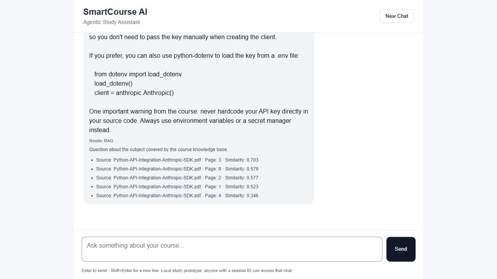
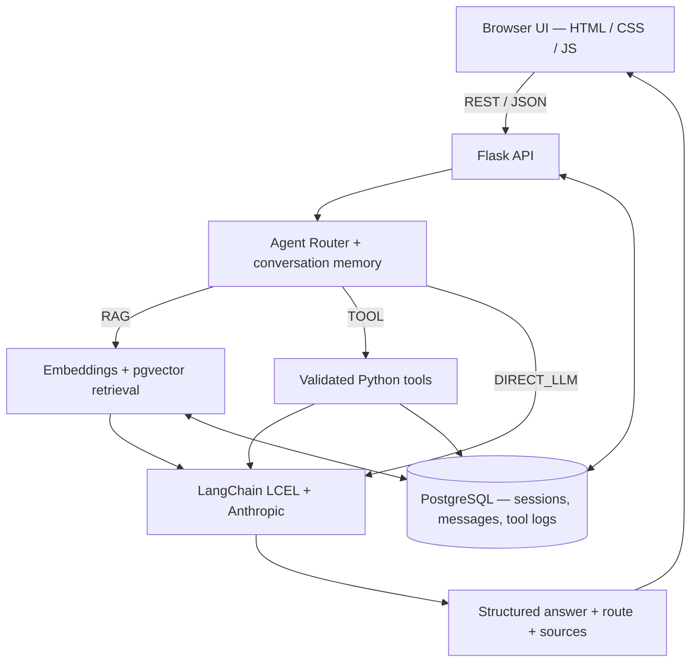

# SmartCourse AI

[](https://github.com/Ayham823/SmartCourseAI/actions/workflows/ci.yml)

**An agentic AI study assistant that routes questions to document-grounded RAG, validated Python tools, or direct LLM responses.**

**Python 3.12 · Flask · Anthropic Claude · LangChain LCEL · PostgreSQL · pgvector · Docker · Vanilla JavaScript**



*Screenshot captured during development with the original academic-course document; the public repository instead ships an original demonstration PDF.*

## Highlights

- **Explainable agent routing:** Deterministic, testable decisions across `RAG`, `TOOL`, and `DIRECT_LLM`, with routing metadata visible in the chat UI.
- **End-to-end RAG:** PDF parsing → overlapping chunks → 384-dimensional MiniLM embeddings → cosine search in PostgreSQL/pgvector → source-grounded Claude response with document/page citations.
- **Real tool execution:** Anthropic tool schemas, argument validation, allowlisted Python handlers, weighted-grade calculations, and structured course lookups; calls and failures are logged to PostgreSQL.
- **Persistent conversations:** UUID sessions, bounded multi-turn context, transactional message persistence, and refresh-safe browser history.
- **Reliability:** Structured API errors, secret-safe configuration, retries for transient provider errors, additive schema migrations, and content-hash PDF deduplication.
- **Tests:** 149 deterministic tests reported passing locally; 7 optional integration/live checks (run separately and may use paid API credits).

## Architecture



More detail: [architecture documentation](docs/architecture.md).

## Five-minute project review

- [Development UI screenshot](docs/demo-ui.png)
- [Architecture and data flow](docs/architecture.md)
- [Reproducible local demo walkthrough](docs/DEMO_SHOTLIST.md) — **not a hosted demo or prerecorded video**
- [Test verification and limitations](docs/verification.md)

## Getting started (local development)

Requirements: Python 3.12, Docker + Docker Compose, an [Anthropic API key](https://console.anthropic.com/), and internet access for the initial embedding model download. Works on Linux / WSL2. No hosted demo is provided.

```bash
git clone https://github.com/Ayham823/SmartCourseAI.git
cd SmartCourseAI
python3.12 -m venv venv
source venv/bin/activate
pip install -r requirements.txt
cp .env.example .env
# Edit .env: set matching PostgreSQL settings, your ANTHROPIC_API_KEY and available ANTHROPIC_MODEL

docker compose up -d
python -m server.database.migrate
python -m server.rag.ingest knowledge/course_documents/sample_course_notes.pdf
python -m server.app
```

Visit **http://localhost:5000**. Verify server/database readiness at `GET /health`.

> Never commit `.env` or share live keys. Running the Anthropic LLM requires a valid account and may incur API charges. The Docker database is configured for local access.

## Try it

| Input | Path | What to expect |
| --- | --- | --- |
| `How do I authenticate with the Anthropic Python SDK according to the sample course PDF?` | **RAG** | Explanation citing `sample_course_notes.pdf` and source pages |
| `Exam 82 (70%), Project 95 (30%). Calculate my final grade.` | **TOOL** | Python-calculated final grade: **85.9** |
| `When is the Final Project deadline?` | **TOOL** | Honest unavailable status until verified records are added |
| `Hello, what can you help me with?` | **DIRECT_LLM** | General study-assistant response |

The included PDF is original sample material, not a redistribution of a university slide deck. You can ingest your own **text-based** PDFs (scanned/image-only PDFs require OCR). Official course records can be supplied to `knowledge/course_info.json` with verification metadata.

## API surface

| Method | Endpoint | Description |
| --- | --- | --- |
| `GET` | `/health` | Flask and PostgreSQL health |
| `POST` | `/sessions` | Create UUID session |
| `POST` | `/chat` | Full router → RAG/tool/direct → model response |
| `GET` | `/history?session_id=<uuid>` | Persisted messages and response metadata |
| `POST` | `/rag/search` | Similarity-search inspection |
| `POST` | `/rag/answer` | Directly test grounded RAG generation |

Chat responses include `answer`, `session_id`, `route`, `tool`, `sources`, and `routing_reason`.

## Tests

```bash
python -m pytest -q
# Opt-in local DB/RAG integration tests; needs Docker database and embedding model
SMARTCOURSE_INTEGRATION_TESTS=1 python -m pytest -q -m 'integration and not live'
# Opt-in paid Anthropic live test
SMARTCOURSE_INTEGRATION_TESTS=1 SMARTCOURSE_LIVE_TESTS=1 python -m pytest -q -m live
```

CI runs deterministic tests only (no API credentials required). The integration and live test results cited above were produced on the original local submission environment, not automatically reverified against every new checkout.

## Project organization

```text
client/                 Browser UI
server/agent/           Routing logic
server/rag/             PDF parsing, embeddings, retrieval, response service
server/tools/           Validated Python tools and Anthropic schemas
server/llm/             LangChain LCEL and model integration
server/database/        PostgreSQL persistence and migrations
server/services/        Conversation orchestration / response formatting
knowledge/              Original sample PDF and lookup fixture
migrations/             Database schema updates
tests/                  Unit and opt-in integration tests
docs/                   Architecture, walkthrough and development screenshot
```

## Design decisions and limitations

- **Explicit routing** makes behavior observable and easier to test than hidden heuristics, but an ambiguous query can still be misclassified.
- **Local pgvector** lets relational messages and vector embeddings share one managed container; a scalable multi-user deployment would require additional safeguards.
- **No user login:** A session UUID is a bearer reference. This is an academic local prototype and **must not be exposed publicly as a shared service** without authentication, authorization, and TLS.
- **RAG scope:** Retrieval quality and multilingual coverage depend on the supplied documents. The public demo ships one small original PDF and no real student data.

See [the walkthrough](docs/demo.md) and [full academic implementation documentation (English + Hebrew)](docs/ACADEMIC_DOCUMENTATION.md).

---

Built as a university final project and extended as a portfolio demonstration of **AI engineering, backend APIs, database design, and testing**.
