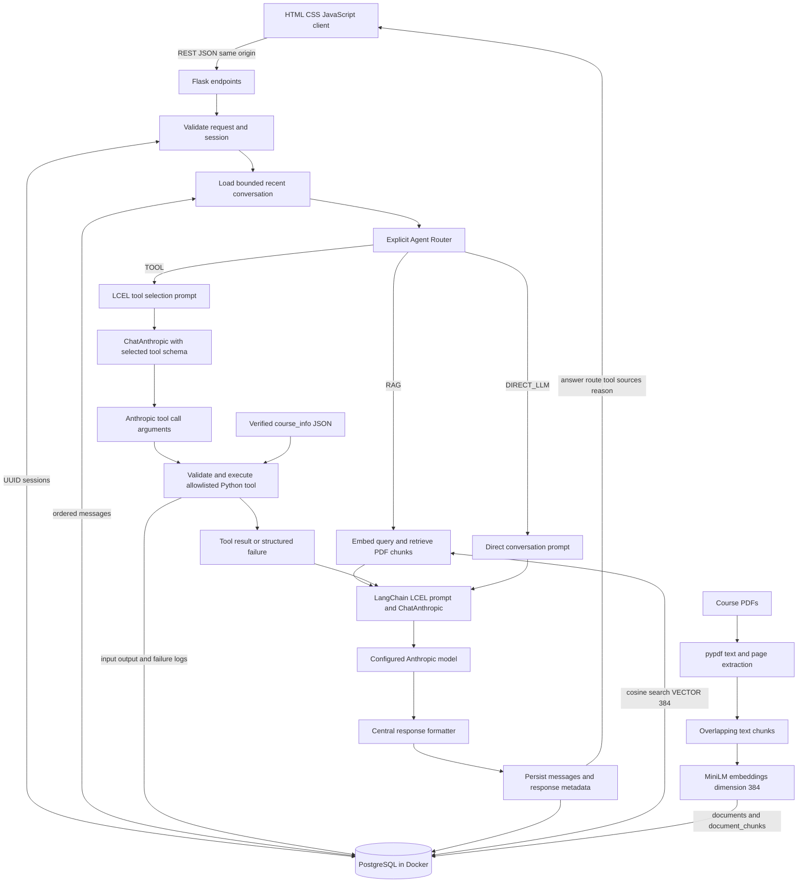

# Architecture

The source below is reproducible Mermaid. It describes the implemented modules and their intended runtime flow; live execution evidence belongs in `verification.md`.

`server/agent/` owns routing, `server/rag/` owns ingestion/retrieval, `server/tools/` owns the tool schemas and execution, `server/llm/` owns orchestration, and `server/database/` owns persistence. The client has no direct connection to Anthropic or PostgreSQL.
